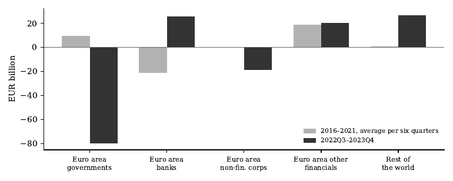

# Monetary Tightening, Policyholder Outflows and Insurers' Bond Sales in the Euro Area

Data and code behind every table and figure of

> Aslan, I. (2026). Monetary tightening, policyholder outflows and insurers' bond sales in the euro area. Working paper, November 2026. [Abstract and PDF](https://ilkeraslan.github.io/papers/monetary-tightening-and-insurers-bond-sales.html)



Insurers are often seen as stabilisers of bond markets. The paper combines quarterly financial-accounts transactions of twenty euro area insurance sectors, 1999 to 2025, with high-frequency ECB policy shocks in panel local projections. Before 2015 a tightening surprise raised inflows to technical reserves and insurers bought long-term debt securities. Since 2015 the same surprise is followed by policyholder outflows and net sales of long-term debt securities, while investment funds buy. Solvency II statistics show that the outflows of 2022–2023 were surrenders.

## Main results

| | Estimate |
|---|---|
| Bond sales per euro of tightening-induced outflow from technical reserves, 2015–2025 | about 40 cents |
| Surrenders in per cent of life technical provisions, euro area | 3.3 before the tightening, 5.5 in 2023 |
| Surrender rate per percentage point of the ten-year yield (19 countries, 2018–2025, country fixed effects) | +0.53 percentage points (s.e. 0.13) |
| Net sales of euro area government debt by euro area insurers, 2022Q3–2023Q4 | about EUR 80 billion |

## Files

| Path | Content |
|---|---|
| `data/` | The source files as downloaded (see Data) |
| `code/build.py` | Country-quarter panel, exposure to guaranteed savings, quarterly shocks |
| `code/lp.py` | Panel local projections with Driscoll–Kraay standard errors |
| `code/robust.py` | Robustness checks and the 2022–2023 episode |
| `code/extra.py` | Splits before and after 2015, guarantee interactions, break test, sample variants |
| `code/figtab.py` | Figures and table bodies |
| `code/mech.py` | Instrumental-variable estimate, sovereign spreads, leave-one-country-out |
| `code/perm.py` | Randomisation inference for the cross-country interaction |
| `code/eiopa.py` | Surrenders and premiums in the Solvency II statistics |
| `code/moneyness.py` | Interaction with a moneyness proxy, reported in the discussion |
| `results/` | Outputs of the code: intermediate data (`*.csv`), estimates (`*.json`), table bodies (`tab_*.tex`) and figures (`fig_*.pdf`) |

Tables and figures by file: Table 1 `tab_desc`, 2 `tab_main`, 3 `tab_sectors`, 4 `tab_guar`, 5 `tab_iv`, 6 `tab_eiopa_agg` and `tab_eiopa_link`, 7 `tab_episode`, 8 `tab_spread`, 9 `tab_robust`; appendix tables `tab_full` and `tab_expo`; Figure 1 `fig_prepost`, 2 `fig_sectors`, 3 `fig_guarantee`, 4 `fig_ea_2022`.

## Running the code

```
python -m pip install -r requirements.txt
cd code
python build.py
python lp.py
python robust.py
python extra.py
python figtab.py
python mech.py
python perm.py
python eiopa.py
python moneyness.py
```

Run the scripts from the `code` folder in this order; together they take about a minute and reproduce the files in `results/`. They were last checked with Python 3.13, pandas 3.0, NumPy 2.5, statsmodels 0.15 and Matplotlib 3.11.

## Data

All series are public and were retrieved in November 2026.

| File | Source |
|---|---|
| `ecb_insurers.csv` | ECB Data Portal: quarterly sector accounts (QSA; transactions and stocks of insurance corporations S.128, investment funds S.124, pension funds S.129 and deposit-taking corporations S.12K), insurance corporation statistics (ICB; technical reserves by country, euro area debt-security transactions by issuer) and long-term interest rate statistics (IRS). Columns: SDMX series key, period, value |
| `eiopa_annual_pce.csv` | EIOPA insurance statistics, solo annual, premiums, claims and expenses (S.05.01): life gross written premiums, claims and total surrenders |
| `eiopa_annual_bs.csv` | EIOPA insurance statistics, solo annual balance sheet (S.02.01): life technical provisions |
| `jk.csv` | ECB monetary policy and central bank information shocks, monthly, from the update of Jarociński and Karadi (2020), file `shocks_ecb_mpd_me_m.csv` in [marekjarocinski/jkshocks_update_ecb](https://github.com/marekjarocinski/jkshocks_update_ecb), licensed CC BY 4.0 |

Jarociński, M. and Karadi, P. (2020). Deconstructing monetary policy surprises: The role of information shocks. *American Economic Journal: Macroeconomics*, 12(2), 1–43. https://doi.org/10.1257/mac.20180090

## Citation

Please cite the paper. GitHub's "Cite this repository" button gives the reference in APA and BibTeX formats.

## Licence

Code: MIT licence (see `LICENSE`). The data are from the public sources listed above and remain subject to their terms; `jk.csv` is redistributed unchanged under CC BY 4.0.

## Author

Ilker Aslan, Lecturer, Kalaidos University of Applied Sciences, Zürich
[ORCID 0000-0001-9241-9420](https://orcid.org/0000-0001-9241-9420) · [ilkeraslan.github.io](https://ilkeraslan.github.io)
